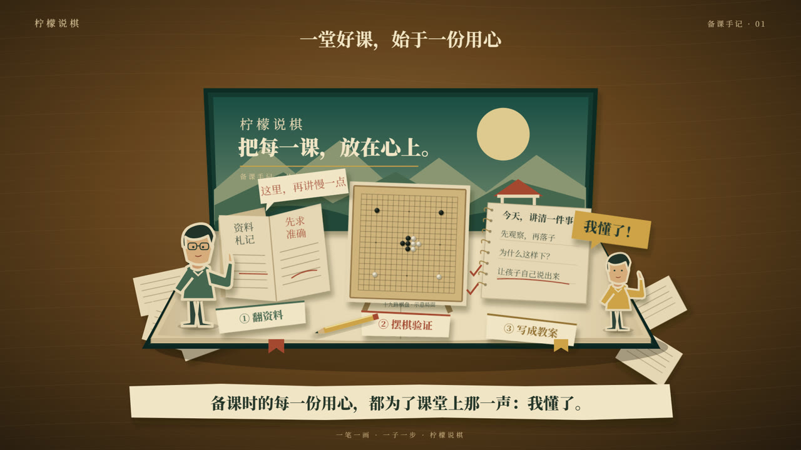

# 柠檬说棋 · 一堂好课，是怎样磨出来的

一部 38.2 秒的纸艺立体书短片：翻资料、亲手摆棋、手写教案、试讲修改，最后迎来孩子的一声「我懂了」。以纸艺人物演绎课程准备过程，不作为真实工作现场纪录。



## 运行与渲染

需要 Node.js 22.18+ 或 24+，npm。首次渲染时 Remotion 可能需要下载 Chrome Headless Shell。

```bash
npm ci
npm run dev
```

打开终端显示的 Studio 地址，选择 LemonCourse。可拖动时间线、播放带旁白的预览。

```bash
npm run check
npm test
npm run render
npm run still
```

- 成片：out/lemon-course.mp4，1920×1080，30 fps，1146 帧，H.264 + AAC。
- 封面：out/cover.png。
- 指定端口：npm run dev -- --port=17820。
- 资源完整包含在 public，渲染不依赖私有服务或账号登录。

## 结构

| 文件 | 内容 |
| --- | --- |
| src/LemonCourse.tsx | 字幕、旁白、配乐、六段时间线 |
| src/BookStage.tsx | 连续开书、弹起、写字与人物动作 |
| src/PaperArt.tsx | 纸偶、手、教案、棋盘等原创 SVG |
| src/board.ts | 19 路网格、九星位、棋子坐标 |
| public/audio | 柠檬老师第二期降噪声线旁白、原创配乐及音效 |
| scripts/make-score.py | 可重建配乐与纸张、棋子音效，仅需 Python 标准库 |
| scripts/validate.mjs | 棋盘、资源和依赖锁验证 |

所有动画都由 Remotion 帧驱动，不使用 CSS 时间动画或随机运行时状态。棋盘与棋子共享坐标，石子是不透明闭合形状；局面仅为画面示意，不是实战棋谱或招法教学。

## 改编说明

从参考作品借鉴暖棕桌面、米白纸张、墨绿书封、立体纸景逐层展开与纸条字幕的视觉语法，以原创 SVG 制作 2.5D 纸艺改编。内容围绕教师备课重新编写，未使用参考片的视频、音乐或截图作为渲染资源。

对应动效片段：[MotionFace](https://motionface.cc/?recording=ad1b3f0a-1770-4743-a28f-9a7ad9c378af)。本仓库不包含绑定凭证、临时签名视频地址或私人音色档案。

字体使用 Noto Serif SC，字体许可证见 public/fonts/OFL.txt。代码和原创视听内容未授予再分发许可；公开仓库供查看、运行及本次片段绑定。Remotion 使用条款见其官方许可。
